# Marcela's COVID-19 Analysis

This project explores trends in COVID-19 cases using the following datasets. The primary data sources include:

- [update and add your own]

These sources provide daily updates on cases, testing, and vaccination metrics across OC.

---

## 📊 Data Loading and Preprocessing in R

Below is an example R script used to load and clean the dataset for analysis:

```r
# Load required packages
library(tidyverse)
library(lubridate)

```
---
## Moran's I for test positivity
Global and local Moran's I tests were run for 4 ZIP-level variables 
(1-3) Test positivity for three 7-month time periods
(4) Vaccination coverage by the end of the study period (November 30, 2021)

**Global Moran's I: Explanation and Summary of Resultss**
- Measures overall spatial autocorrelation across study area
- Positive values (values >0) indicate that similar values are clustered throughout the entire study area. Negative values indicate dispersion. Value close to zero suggests random spatial pattern.
- Good for assessing overall pattern of spatial relationships or clustering in the data, but does not provide information on specific locations or local patterns
-Statistic standard deviate is the standardized measure of Moran's I value; it's a z-score
- P-value tests null hypothesis that there is no spatial autocorrelation. Values below alpha (0.05) indicate strong evidence against null hypothesis (presence on spatial autocorrelation, not likely due to chance)
- The alternative hypothesis tested was that the observed Moran's I value is greater than what would be expected under random spatial distribution
 
*Results Summary:*
- Statistically significant strong positive spatial autocorrelation for test positivity for the first two time period (strong tendency for similar values to be clustered together)
- Moran's I drops a bit for the third time period, suggesting a lower degree of clustering (moderately positive spatial autocorrelation)
- Statistically significant moderate positive spatial autocorrelation for vaccination coverage as of November 30, 2021.
- Positive spatial autocorrelation (values >0) for all four variables suggest that similar values for test positivity/coverage are more likely to found near each other geographically.

**Local Moran's I Explanation:** 
- Also referred to as Local Spatial Autocorrelation (LISA)
- Measures spatial autocorrelation in specific locations and identifies hotspots, cold spots, and spatial outliers
- One statistic per feature (ZIP code) showing where high or low spatial correlations are concentrated. Good for identifying local patterns and clustering
- High positive values greater than 1 signal clustering of similar values (high-high or low-low clusters). Negative values may indicate spatial outliers.

  
### Results for Test Posivitity Time Period 1: March 2020 - September 2020 
Context: Wild-type variant is the dominant strain during this time period. Testing infrastructure developing. Vaccines not available to public yet.

Add image of time period 1 map here 

*Global Moran's I Results*
Statistic Standard Deviate = 8.0736
P-value = 3.143e-16
Alternative Hypothesis: Greater
Moran I Statistic: 0.52109844
Expectation: -0.01190476
Variance: 0.00435839

*Local Moran's I Results*

###Test Posivitity Time Period 2: October 2020 - April 2021
Context: Alpha variant is dominant during this time period. First large winter wave. Vaccines rolled out to the public during this time period.

Add image of time period 2 map here 

*Global Moran's I Results*
Statistic Standard Deviate = 8.1653
P-value < 2.2e-16
Alternative Hypothesis: Greater
Moran I Statistic: 0.532781289
Expectation: -0.011904762
Variance: 0.00449855

*Local Moran's I Results*


### Test Posivitity Time Period 3: May 2021 - November 2021
Context: Delta variant becomes dominant variant worldwide by June 2021. Vaccines are fully available to public. Ends right before the omicron variant takes over in December 2021.

Add image of time period 3 map here 

*Global Moran's I Results*
Statistic Standard Deviate = 5.5878
P-value = 1.15e-08
Alternative Hypothesis: Greater
Moran I Statistic: 0.360877725
Expectation: -0.01190476
Variance: 0.00445077

*Local Moran's I Results*


### Vaccination Coverage by November 30, 2021
Context: vaccination coverage just before boosters become recommended for all adults 18 and older 

Add vaccination coverage map 

*Global Moran's I Results*
Statistic Standard Deviate = 3.1215
P-value = 0.0008998
Alternative Hypothesis: Greater
Moran I Statistic: 0.193659383
Expectation: -0.01190476
Variance: 0.004336903

*Local Moran's I Results*


### R Code (spdep package)

```r

#loading in spatial data

geojson_data <- st_read("/Users/marcela/Desktop/Aim 1/JSON_layer.geojson")

#convert to spatial object
geojson_sp <- as(geojson_data, "Spatial")

#create neighbors
nb <- poly2nb(geojson_sp)

#create spatial weights
lw <- nb2listw(nb, style="W")

#GLOBAL
#Calculate Moran's I for test positivity - time period 1 
moran_result_P1 <- moran.test(geojson_sp$P1, lw)
print(moran_result_P1)

#Calculate Moran's I for test positivity - time period 2 
moran_result_P2 <- moran.test(geojson_sp$P2, lw)
print(moran_result_P2)

#Calculate Moran's I for test positivity - time period 3 
moran_result_P3 <- moran.test(geojson_sp$P3, lw)
print(moran_result_P3)

#Calculate Moran's I for vaccination  
moran_result_ZIP_vax <- moran.test(geojson_sp$ZIP_vax_Nov_2021, lw)
print(moran_result_ZIP_vax)

#LOCAL

local_moran_P1_result <- localmoran(geojson_sp$P1, lw)
geojson_sp$local_moran_P1 <- local_moran_P1_result[, 1]  

local_moran_P2_result <- localmoran(geojson_sp$P2, lw)
geojson_sp$local_moran_P2 <- local_moran_P2_result[, 1] 

local_moran_P3_result <- localmoran(geojson_sp$P3, lw)
geojson_sp$local_moran_P3 <- local_moran_P3_result[, 1]  

#Vaccination: 
local_moran_vax_result <- localmoran(geojson_sp$ZIP_vax_Nov_2021, lw)
geojson_sp$local_moran_vax <- local_moran_vax_result[, 1] 

```


---
## Conference Abstract 

*As of 05.03.2025* 

**Title:** Demographic Disparities and Vaccine Coverage: Predictors of SARS-CoV-2 Test Positivity in Orange County, California   

**Authors:** Marcela Lopez, Tetyana I. Vasylyeva, Daniel M. Parker  

**Background:** COVID-19, caused by the severe acute respiratory syndrome coronavirus 2 (SARS-CoV-2), was declared a pandemic in March 2020. Vaccines against SARS-CoV-2 became available to residents in Orange County, California, in phases starting in December 2020. Previous work has identified gender, age, race, and place of residence as potential risk factors for infection.   

**Objective:** Using surveillance data, vaccination rates, and Census data, we assessed how demographic risk factors, neighborhood characteristics, and vaccination coverage influenced odds of SARS-CoV-2 infection in Orange County. We expected men, racially minoritized individuals, and individuals living in communities with greater population density to have higher odds of testing positive for COVID-19.   

**Methods:** We linked daily reported test records collated by the Orange County Health Care Agency from March 2020 to November 2021 with SARS-CoV-2 vaccination data from the California Open Data Portal and ZIP-code-level attributes from the U.S. Census Bureau (n=1,799,693). We fit generalized additive models with binomial family distributions to model test positivity as a function of individuals’ gender, age, race/ethnicity, ZIP-code population density, ZIP-code household density, the proportion of residents aged ≥65 years in each ZIP code, and age-group-specific vaccination rates – while accounting for time and location (ZIP-code geographic centroids).   

**Results:** Men had 12% increased odds of testing positive for COVID-19 compared to women (aOR: 1.12; 95% CI: 1.11, 1.13). Hispanic/Latinx individuals had over twice the odds of infection compared to Non-Hispanic White individuals (aOR: 2.19; 95% CI: 2.16, 2.22).  Those aged 80-100 years had 30% decreased odds compared to those aged 18-24 (aOR: 0.70; 95% CI: 0.68-0.72). We found an inverse relationship between test positivity and proportion of the age group vaccinated, with decreased odds of an individual testing positive after approximately 40% of their respective age group had been vaccinated. Age-stratified analyses indicated that this protective effect differed by age group, with those <65 seeing protective effects earlier than those ≥65.  

**Discussion:** Male sex and Hispanic/Latinx ethnicity were risk factors for COVID-19 infection. Even relatively moderate levels of vaccination coverage could be indirectly protective against infection. Despite earlier vaccination access, adults over 65 saw delayed protective effects, suggesting age-related differences in herd immunity.  

*350 words, excluding authors and titles*

---

## 📊 Figures

### Forest Plot for Full Model

*Version 1  - square aOR with no vertical bars for lower and upper bounds*

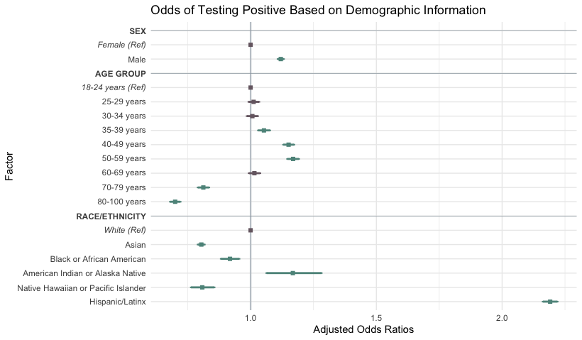  

*Version 2  - cicle aOr with with vertical bars at lower and upper bounds*

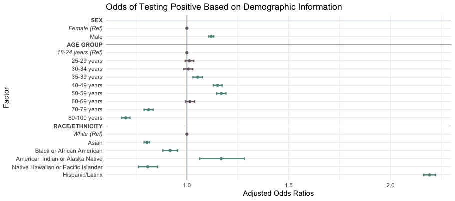


### Updated Pandemic Timeline Figure - Vaccine Coverage Plot

*Version 1 - Points where splines crossed 0*  

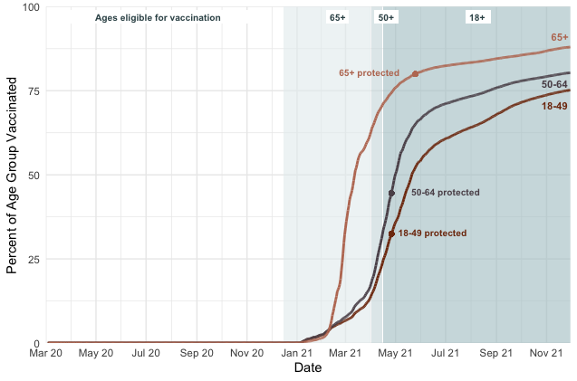

*Version 2 - Dashed line where spline crossed 0*  

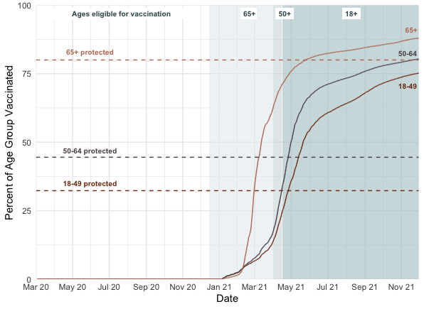  

*Version 3 - Dashed lines where confidence band crossed 0*  

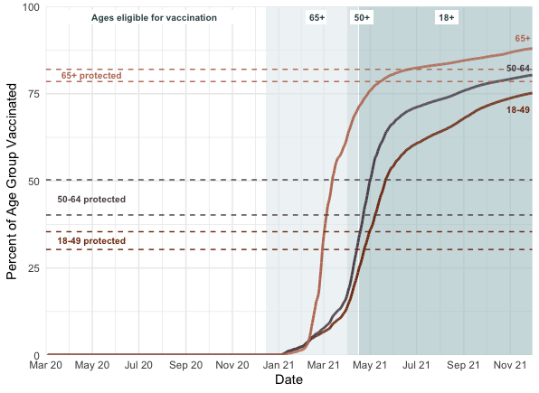  

*Version 4 - Color bands where confidence band crossed 0*

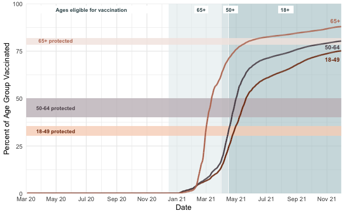

*Version 5 - Full Version*

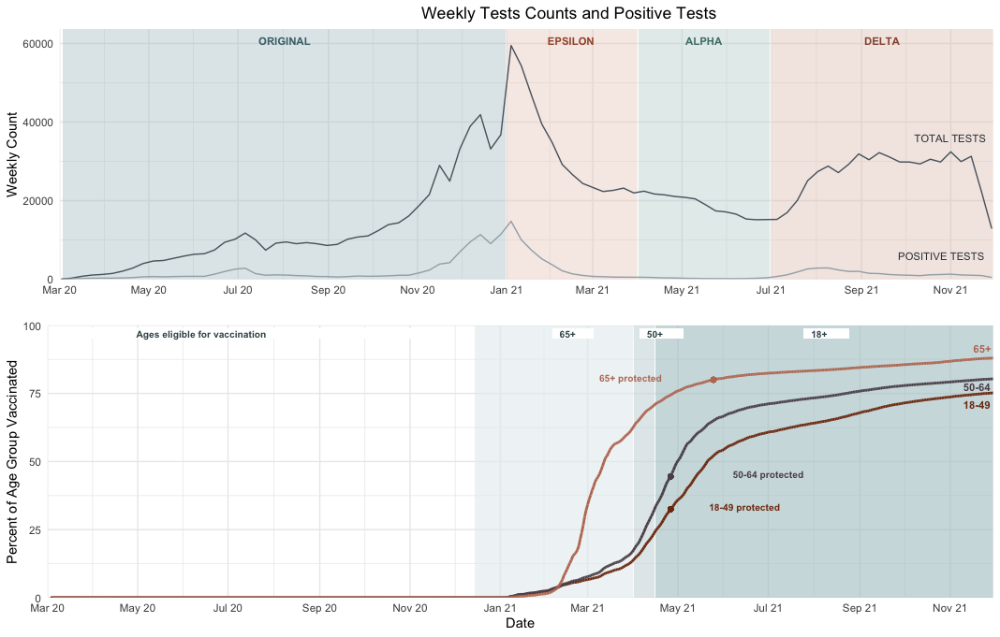


### Pandemic Timeline
 
The following figure is an attempt to synthesize as much information as possible. The timelines across the three levels are lined up to contextualize findings and so that comparisons can be made across time. 

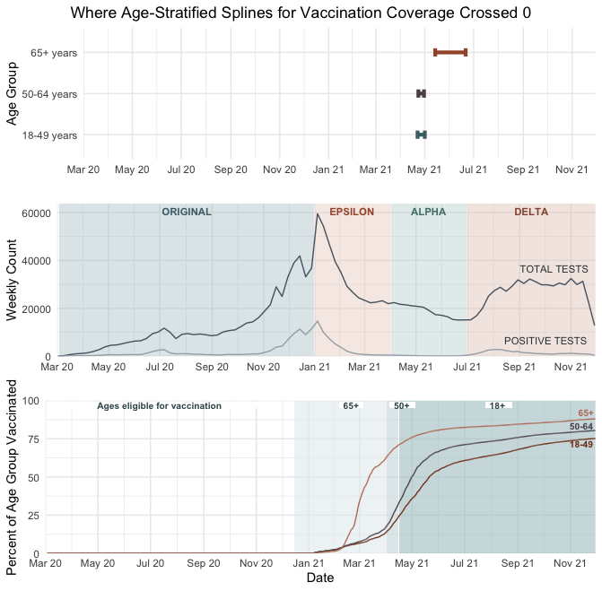


---
## Full Model

Time Period: March 2020 - November 2021  
Percent vaccinated and time are two separate variables and not included in an interaction term. 

```r
full_model =  bam(Positive ~ Sex + Agegroup + Race_or_ethnicity + s(Percent_hh_4_or_more, k=-1, bs = "ts") +
                        s(PopDens, k=-1, bs = "ts") + s(Week, k=-1, bs = "ts") 
                      + s(Percent_of_age_group_fully_vaccinated, k=-1, bs = "ts") 
                      + s(Percent_over_65, k = -1, bs = "ts")
                      + s(Longitude, Latitude, k = -1, bs = "sos"),
                      family = binomial, data = Final_dataset, 
                      method="fREML", select = TRUE, gamma = 1.4, nthreads=8)   
```
**Splines for Main Model**  

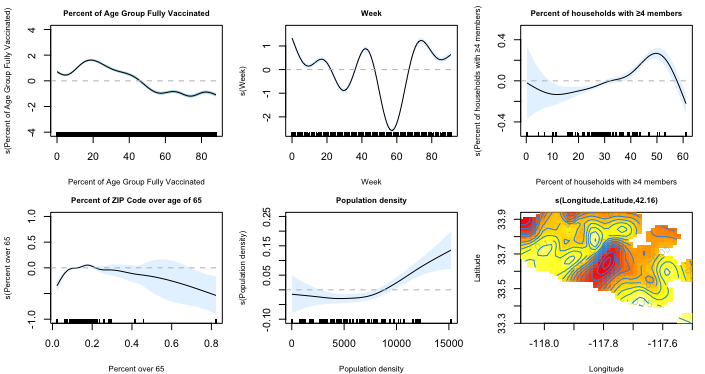

From this model, we can see that the percent of age group fully vaccinated is generally inversely related to the log-odds of testing positive for COVID-19. By the time a patients’ age group was over 40% vaccinated, their log odds of testing positive became less than 0. 

The spline function for week has a lot of knots and suggests a non-linear relationship between time and test results.

The downward trend observed with the spline for percent of households with ≥4 members is something that may specifically be driven by the <50 population, as the spline for the full model most closely resembles the spline for the same variable for the 18-49 age group. 

The spline for percent of ZIP code over the age of 65 has a confidence band that widens as percentage increases. Looking at the rug plot, this makese sense as there are less observations with increased percentage. The general downward trend matches the oldest age groups' decreased odds of testing positive, compared to the youngest age group. However, the confidence band includes 0 for most percentages.

ZIP code population density became positively associated with log-odds of testing positive at 9,000 people per square kilometer. Patients living in ZIP codes with densities ≥9,000 people per square kilometer had positive log-odds of testing positive.


---
## Models Stratified by Age Group

Fixed on 04.16.2025 to include entire time period (March 2020 - November 2021)  
Models contain all variables from the final model, where percent vaccinated and week are separate variables (no interaction term)

Percent vaccinated has not been lagged by any time.

**Filtering by age group:**
```r
#Filtering main dataset (named Final_dataset) into 3 groups
Group1 <- Final_dataset %>% 
  filter(Age >= 18 & Age <= 49)

Group2 <- Final_dataset %>% 
  filter(Age >= 50 & Age <= 64)

Group3 <- Final_dataset %>% 
  filter(Age >= 65)
```

**Models:**
```r
#Group 1
group1_pre_omicron =  bam(Positive ~ Sex + Agegroup + Race_or_ethnicity + s(Percent_hh_4_or_more, k=-1, bs = "ts") +
                              s(PopDens, k=-1, bs = "ts") + s(Week, k=-1, bs = "ts") 
                            + s(Percent_of_age_group_fully_vaccinated, k=-1, bs = "ts") 
                            + s(Percent_over_65, k = -1, bs = "ts")
                            + s(Longitude, Latitude, k = -1, bs = "sos"),
                            family = binomial, data = Group1, 
                            method="fREML", select = TRUE, gamma = 1.4, nthreads=8)  
print(summary(group1_pre_omicron))
AIC(group1_pre_omicron)

#Group 2
group2_pre_omicron =  bam(Positive ~ Sex + Agegroup + Race_or_ethnicity + s(Percent_hh_4_or_more, k=-1, bs = "ts") +
                              s(PopDens, k=-1, bs = "ts") + s(Week, k=-1, bs = "ts") 
                            + s(Percent_of_age_group_fully_vaccinated, k=-1, bs = "ts") 
                            + s(Percent_over_65, k = -1, bs = "ts")
                            + s(Longitude, Latitude, k = -1, bs = "sos"),
                            family = binomial, data = Group2, 
                            method="fREML", select = TRUE, gamma = 1.4, nthreads=8)  
print(summary(group2_pre_omicron))
AIC(group2_pre_omicron)

group3_pre_omicron =   bam(Positive ~ Sex + Agegroup + Race_or_ethnicity + s(Percent_hh_4_or_more, k=-1, bs = "ts") +
                               s(PopDens, k=-1, bs = "ts") + s(Week, k=-1, bs = "ts") 
                             + s(Percent_of_age_group_fully_vaccinated, k=-1, bs = "ts") 
                             + s(Percent_over_65, k = -1, bs = "ts")
                             + s(Longitude, Latitude, k = -1, bs = "sos"),
                             family = binomial, data = Group3, 
                             method="fREML", select = TRUE, gamma = 1.4, nthreads=8)  
print(summary(group3_pre_omicron))
AIC(group3_pre_omicron)
```

AIC group 1: 589,230   
AIC group 2: 229,137.2  
AIC group 3: 153,026.1  

**Splines for Group 1: ages 18 -49**  

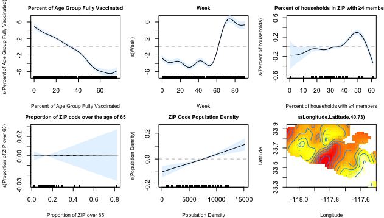


**Splines for Group 2: ages 50-64**  

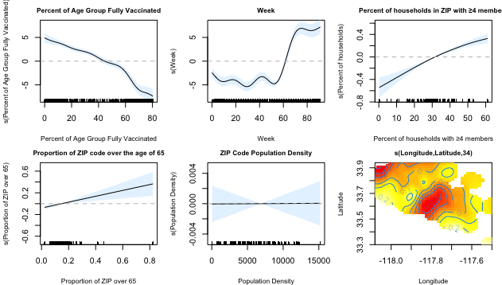


**Splines for Group 3: ages 65+**  

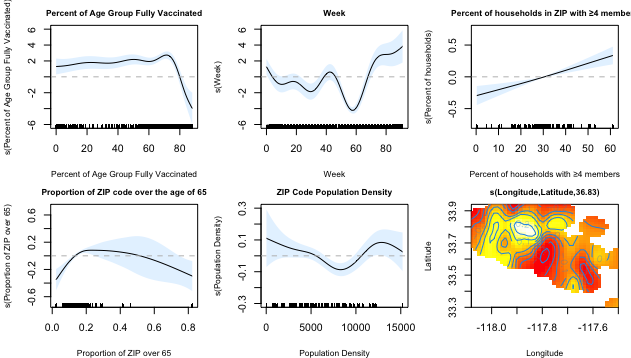

After correcting the time period to include all samples from March 2020 - November 2021, the spline functions for all three age groups display similar downward trends with increasing percentage of vaccination, with coefficients ranging from 6 to -6. This downward trends is similar to the one from the full model shown above. We are no longer seeing an uptick at the end. 

For age group 1 (18-49), the spline function crosses zero at around 35%. For age group 2 (50-64%), the spline crosses zero at around 40-45%. For the eldest age group (65+), it crosses zero at around 75%. 

After discussing these findings with Tanya on Tuesday, 4.22., I'd like to explore the following question: 
*Do these percentages reflect the same period or did these groups reach these percentages at different times?* If the former, then these splines reflect a county-wide tipping point, at which all groups became protected. If the latter is true, then different age groups became protected earlier than others, reflecting potential behavioral differences or consequences of staggered vaccine administration. 

The splines for percent of households with ≥4 members differ slightly by age. While all three groups show a general upward trend, the spline for the first age group drops down again towards the end.  For two older age groups (50-64 and 65+), the splines start at around -0.5 and cross zero at around 30%. Therefore, we can conclude that OC residents living in ZIP codes where >30% of households at 4 or more members had increased odds of testing positive for COVID-19. 

The splines for proportion of ZIP code over the age of 65 and for ZIP code population density hover at around 0. Confidence bands include 0 for large sections

---
## Full Model with Vaccination Coverage Lagged by 1 month
Time period: March 2020 - November 2020  
Includes all variables from full model, except vaccination coverage has been lagged by 1 month. Model does not include the original vaccination coverage variable nor the 2-month lagged variable. 
```r
bam_1_month_lag = bam(Positive ~ Sex + Agegroup + Race_or_ethnicity + s(Percent_hh_4_or_more, k=-1, bs = "ts") +
                             s(PopDens, k=-1, bs = "ts") + s(Week, k=-1, bs = "ts") 
                           + s(Percent_agegroup_fully_vaxxed_1ml, k=-1, bs = "ts") 
                           + s(Percent_over_65, k = -1, bs = "ts")
                           + s(Longitude, Latitude, k = -1, bs = "sos"),
                           family = binomial, data = Final_dataset, 
                           method="fREML", select = TRUE, gamma = 1.4, nthreads=8)  
print(summary(bam_1_month_lag))
AIC(bam_1_month_lag)

```
AIC: 976,608.1

**Splines for full model lagged by 1 month**


---

## Models Stratified by Age Group, Vaccination Coverage Lagged by 1 month

Fixed on 04.16.2025 to include entire time period (March 2020 - November 2021)
They contain all variables from the final model, where percent vaccinated and week are separate variables (no interaction term)

Percent vaccinated has been lagged by 1 month

**Models:**
```r
#Group 1
group1_1m_lag =  bam(Positive ~ Sex + Agegroup + Race_or_ethnicity + s(Percent_hh_4_or_more, k=-1, bs = "ts") +
                            s(PopDens, k=-1, bs = "ts") + s(Week, k=-1, bs = "ts") 
                          + s(Percent_agegroup_fully_vaxxed_1ml, k=-1, bs = "ts") 
                          + s(Percent_over_65, k = -1, bs = "ts")
                          + s(Longitude, Latitude, k = -1, bs = "sos"),
                          family = binomial, data = Group1, 
                          method="fREML", select = TRUE, gamma = 1.4, nthreads=8)  
print(summary(group1_1m_lag))
AIC(group1_1m_lag)

#Group 2
group2_1m_lag =  bam(Positive ~ Sex + Agegroup + Race_or_ethnicity + s(Percent_hh_4_or_more, k=-1, bs = "ts") +
                            s(PopDens, k=-1, bs = "ts") + s(Week, k=-1, bs = "ts") 
                          + s(Percent_agegroup_fully_vaxxed_1ml, k=-1, bs = "ts") 
                          + s(Percent_over_65, k = -1, bs = "ts")
                          + s(Longitude, Latitude, k = -1, bs = "sos"),
                          family = binomial, data = Group2, 
                          method="fREML", select = TRUE, gamma = 1.4, nthreads=8)  
print(summary(group2_1m_lag))
AIC(group2_1m_lag)

#Group 3
group3_1m_lag =   bam(Positive ~ Sex + Agegroup + Race_or_ethnicity + s(Percent_hh_4_or_more, k=-1, bs = "ts") +
                             s(PopDens, k=-1, bs = "ts") + s(Week, k=-1, bs = "ts") 
                           + s(Percent_agegroup_fully_vaxxed_1ml, k=-1, bs = "ts") 
                           + s(Percent_over_65, k = -1, bs = "ts")
                           + s(Longitude, Latitude, k = -1, bs = "sos"),
                           family = binomial, data = Group3, 
                           method="fREML", select = TRUE, gamma = 1.4, nthreads=8)  
print(summary(group3_1m_lag))
AIC(group3_1m_lag)
```

AIC group 1: 589,013.9  
AIC group 2: 229,045.9  
AIC group 3: 152,956.1  

**Splines for Group 1: ages 18 -49**  

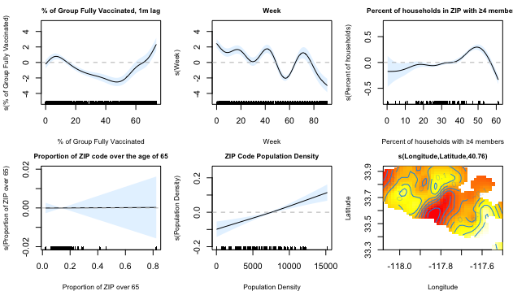


**Splines for Group 2: ages 50-64**  


**Splines for Group 3: ages 65+**  

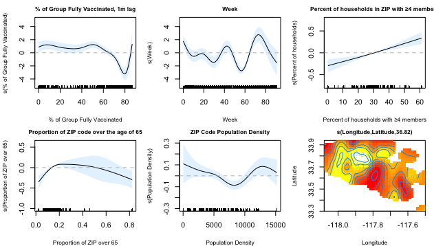

When delaying vaccination coverage by a month, the spline functions for vaccination coverage for all three age group shifted over to the left, with the splines crossing zero at 15%, 15%, and 65% respectively. As a check to the question posed underneath the non-lagged age-stratified spline functions, it will be good to check whether these percentages also line up with the same time period.

Of note, all three splines for vaccination coverage inflect upward at 50%, 60%, and 80%. 

---

## Full Model with Vaccination Coverage Lagged by 2 months

Time period: March 2020 - November 2020  
Includes all variables from full model, except vaccination coverage has been lagged by 2 months. Model does not include the original vaccination coverage variable nor the 1-month lagged variable. 

```r
bam_2_month_lag = bam(Positive ~ Sex + Agegroup + Race_or_ethnicity + s(Percent_hh_4_or_more, k=-1, bs = "ts") +
                        s(PopDens, k=-1, bs = "ts") + s(Week, k=-1, bs = "ts") 
                      + s(Percent_agegroup_fully_vaxxed_2ml, k=-1, bs = "ts") 
                      + s(Percent_over_65, k = -1, bs = "ts")
                      + s(Longitude, Latitude, k = -1, bs = "sos"),
                      family = binomial, data = Final_dataset, 
                      method="fREML", select = TRUE, gamma = 1.4, nthreads=8)  
print(summary(bam_2_month_lag))
AIC(bam_2_month_lag)
```
AIC: 976,764.3

**Splines for full model lagged by 2 months**
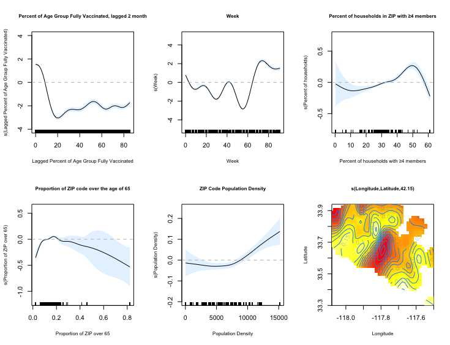


## Age Stratified Models, Lagged by 2 months

Fixed on 04.16.2025 to include entire time period (March 2020 - November 2021)
They contain all variables from the final model, where percent vaccinated and week are separate variables (no interaction term)

Percent vaccinated has been lagged by 2 months

**Models**
```r
#Group 1
group1_2m_lag =  bam(Positive ~ Sex + Agegroup + Race_or_ethnicity + s(Percent_hh_4_or_more, k=-1, bs = "ts") +
                            s(PopDens, k=-1, bs = "ts") + s(Week, k=-1, bs = "ts") 
                          + s(Percent_agegroup_fully_vaxxed_2ml, k=-1, bs = "ts") 
                          + s(Percent_over_65, k = -1, bs = "ts")
                          + s(Longitude, Latitude, k = -1, bs = "sos"),
                          family = binomial, data = Group1, 
                          method="fREML", select = TRUE, gamma = 1.4, nthreads=8)  
print(summary(group1_2m_lag))
AIC(group1_2m_lag)

#Group 2
group2_2m_lag =  bam(Positive ~ Sex + Agegroup + Race_or_ethnicity + s(Percent_hh_4_or_more, k=-1, bs = "ts") +
                            s(PopDens, k=-1, bs = "ts") + s(Week, k=-1, bs = "ts") 
                          + s(Percent_agegroup_fully_vaxxed_2ml, k=-1, bs = "ts") 
                          + s(Percent_over_65, k = -1, bs = "ts")
                          + s(Longitude, Latitude, k = -1, bs = "sos"),
                          family = binomial, data = Group2, 
                          method="fREML", select = TRUE, gamma = 1.4, nthreads=8)  
print(summary(group2_2m_lag))
AIC(group2_2m_lag)

#Group 3
group3_2m_lag =   bam(Positive ~ Sex + Agegroup + Race_or_ethnicity + s(Percent_hh_4_or_more, k=-1, bs = "ts") +
                             s(PopDens, k=-1, bs = "ts") + s(Week, k=-1, bs = "ts") 
                           + s(Percent_agegroup_fully_vaxxed_2ml, k=-1, bs = "ts") 
                           + s(Percent_over_65, k = -1, bs = "ts")
                           + s(Longitude, Latitude, k = -1, bs = "sos"),
                           family = binomial, data = Group3, 
                           method="fREML", select = TRUE, gamma = 1.4, nthreads=8)  
print(summary(group3_2m_lag))
AIC(group3_2m_lag)
```

AIC group 1: 589,185.9  
AIC group 2: 229,073.2  
AIC group 3: 152,975.1  

**Splines for Group 1: ages 18 -49**  

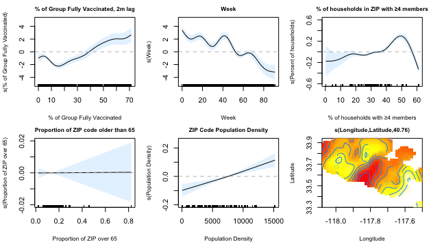


**Splines for Group 2: ages 50-64**  

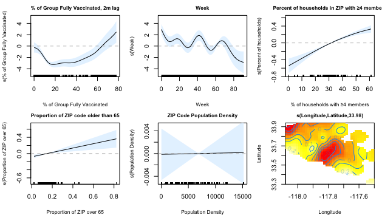


**Splines for Group 3: ages 65+**  

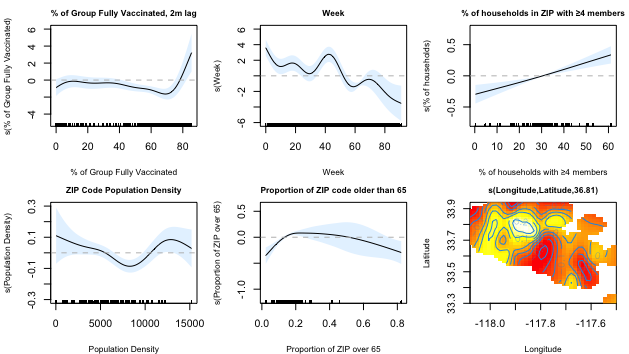

---

## Full Model with Interaction Term

Time period: March 2020 - November 2020  
Models contain all variables from the final model, except that percent vaccinated and week are included as one interaction term. 

```r
interaction_only =  bam(Positive ~ Sex + Agegroup + Race_or_ethnicity  
                        + s(Week, Percent_of_age_group_fully_vaccinated, k=-1, bs = "ts")
                        + s(Percent_hh_4_or_more, k=-1, bs = "ts") 
                        + s(Percent_over_65, k = -1, bs = "ts")
                        + s(PopDens, k=-1, bs = "ts") 
                        + s(Longitude, Latitude, k = -1, bs = "sos"),
                        family = binomial, data = Final_dataset, 
                        method="fREML", select = TRUE, gamma = 1.4, nthreads=8)   
summary(interaction_only)
AIC(interaction_only)
```
AIC: 975,214.5

**Splines for full model with interaction term**
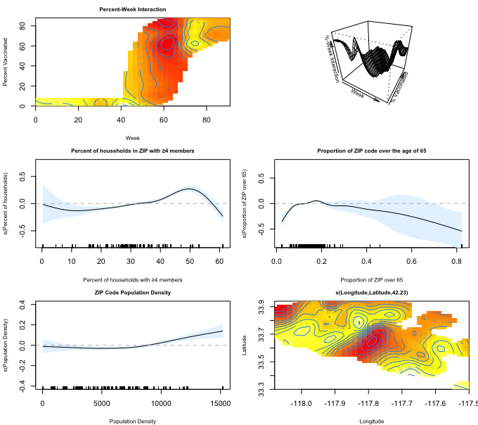


## Models Stratified by Age Group, with Interaction Term

Time period (March 2020 - November 2021)
Models contain all variables from the final model, except that percent vaccinated and week are included as one interaction term. 
Percent vaccinated has not been lagged by any time.

**Models:**
```r
group1_int =  bam(Positive ~ Sex + Agegroup + Race_or_ethnicity  
                           + s(Week, Percent_of_age_group_fully_vaccinated, k=-1, bs = "ts")                     
                            +s(Percent_hh_4_or_more, k=-1, bs = "ts") 
                            +s(Percent_over_65, k = -1, bs = "ts") 
                            +s(PopDens, k=-1, bs = "ts") 
                           +s(Longitude, Latitude, k = -1, bs = "sos"),
                          family = binomial, data = Group1, 
                          method="fREML", select = TRUE, gamma = 1.4, nthreads=8)  
print(summary(group1_int))

group2_int =  bam(Positive ~ Sex + Agegroup + Race_or_ethnicity                             
                           + s(Week, Percent_of_age_group_fully_vaccinated, k=-1, bs = "ts")              
                          +s(Percent_hh_4_or_more, k=-1, bs = "ts") 
                          +s(Percent_over_65, k = -1, bs = "ts") 
                          +s(PopDens, k=-1, bs = "ts") 
                          +s(Longitude, Latitude, k = -1, bs = "sos"),
                          family = binomial, data = Group2, 
                          method="fREML", select = TRUE, gamma = 1.4, nthreads=8)  
print(summary(group2_int))

group3_int =   bam(Positive ~ Sex + Agegroup + Race_or_ethnicity                             
                           + s(Week, Percent_of_age_group_fully_vaccinated, k=-1, bs = "ts")                     
                           +s(Percent_hh_4_or_more, k=-1, bs = "ts") 
                           +s(Percent_over_65, k = -1, bs = "ts") 
                           +s(PopDens, k=-1, bs = "ts") 
                           +s(Longitude, Latitude, k = -1, bs = "sos"),
                           family = binomial, data = Group3, 
                           method="fREML", select = TRUE, gamma = 1.4, nthreads=8)  
print(summary(group3_int))

AIC(group1_int)
AIC(group2_int)
AIC(group3_int)
```

AIC group 1: 588,278.9   
AIC group 2: 228,726.1  
AIC group 3: 152,749  


**Splines for Group 1: ages 18 -49**  

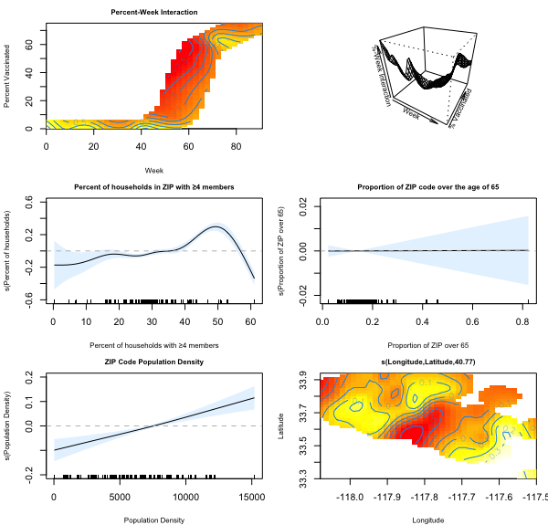

**Splines for Group 2: ages 50-64**  

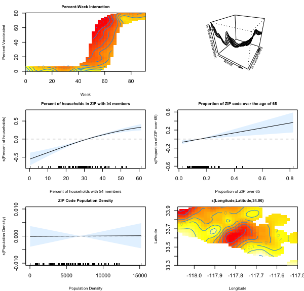

**Splines for Group 3: ages 65+**   

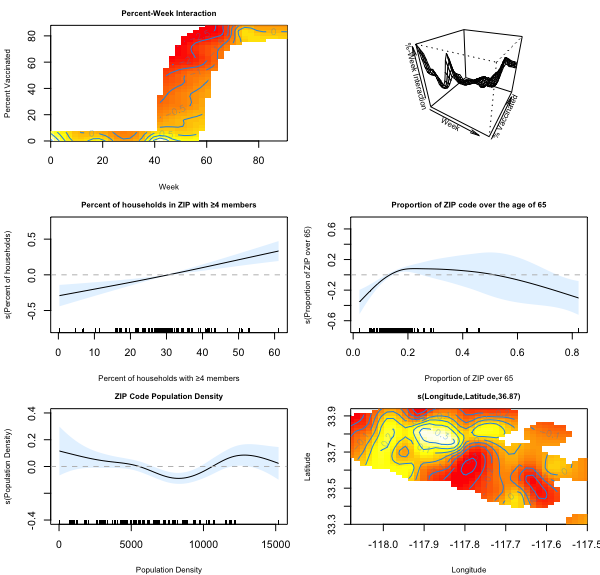 

---

## Models Stratified by Age Group, with Interaction Term and 1-Month Lag

Includes entire time period (March 2020 - November 2021)
Models contain all variables from the final model, except that percent vaccinated and week are included as one interaction term. 
Percent vaccinated is lagged by 1 month.

**Models:**
```r
group1_1m_int =  bam(Positive ~ Sex + Agegroup + Race_or_ethnicity  
                  + s(Week, Percent_agegroup_fully_vaxxed_1ml, k=-1, bs = "ts")            
                  +s(Percent_hh_4_or_more, k=-1, bs = "ts") 
                  +s(Percent_over_65, k = -1, bs = "ts") 
                  +s(PopDens, k=-1, bs = "ts") 
                  +s(Longitude, Latitude, k = -1, bs = "sos"),
                  family = binomial, data = Group1, 
                  method="fREML", select = TRUE, gamma = 1.4, nthreads=8)  
print(summary(group1_1m_int))

group2_1m_int =  bam(Positive ~ Sex + Agegroup + Race_or_ethnicity                             
                  + s(Week, Percent_agegroup_fully_vaxxed_1ml, k=-1, bs = "ts")                       
                  +s(Percent_hh_4_or_more, k=-1, bs = "ts") 
                  +s(Percent_over_65, k = -1, bs = "ts") 
                  +s(PopDens, k=-1, bs = "ts") 
                  +s(Longitude, Latitude, k = -1, bs = "sos"),
                  family = binomial, data = Group2, 
                  method="fREML", select = TRUE, gamma = 1.4, nthreads=8)  
print(summary(group2_1m_int))

group3_1m_int =   bam(Positive ~ Sex + Agegroup + Race_or_ethnicity                             
                   + s(Week, Percent_agegroup_fully_vaxxed_1ml, k=-1, bs = "ts")                        
                   +s(Percent_hh_4_or_more, k=-1, bs = "ts") 
                   +s(Percent_over_65, k = -1, bs = "ts") 
                   +s(PopDens, k=-1, bs = "ts") 
                   +s(Longitude, Latitude, k = -1, bs = "sos"),
                   family = binomial, data = Group3, 
                   method="fREML", select = TRUE, gamma = 1.4, nthreads=8)  
print(summary(group3_1m_int))

AIC(group1_1m_int)
AIC(group2_1m_int)
AIC(group3_1m_int)
```

AIC group 1: 588,401.4    
AIC group 2: 228,764.8  
AIC group 3: 152,743.3  


**Splines for Group 1: ages 18 -49**  

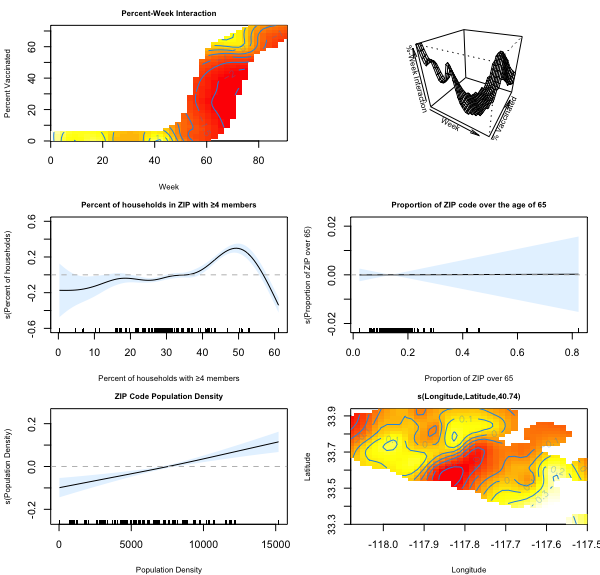

**Splines for Group 2: ages 50-64**  

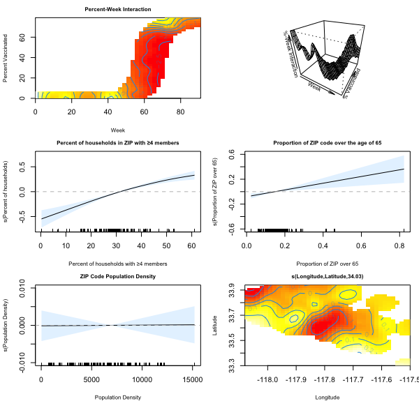

**Splines for Group 3: ages 65+**  

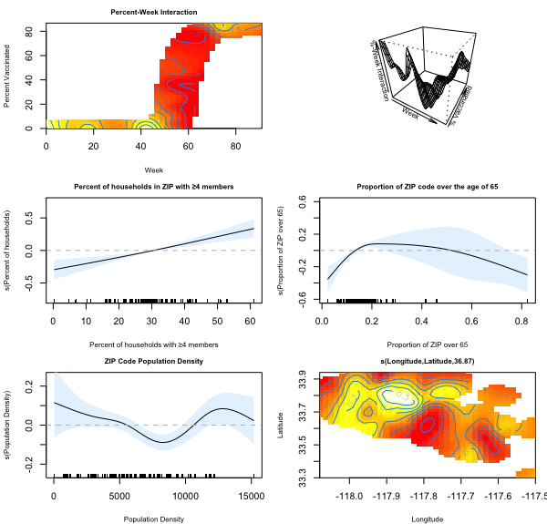

---

## Models Stratified by Age Group, with Interaction Term and 2-Month Lag

Includes entire time period (March 2020 - November 2021)
Models contain all variables from the final model, except that percent vaccinated and week are included as one interaction term. 
Percent vaccinated has been lagged by 2 months.

**Models:**
```r
group1_2m_int =  bam(Positive ~ Sex + Agegroup + Race_or_ethnicity  
                  + s(Week, Percent_agegroup_fully_vaxxed_2ml, k=-1, bs = "ts")                      
                  +s(Percent_hh_4_or_more, k=-1, bs = "ts") 
                  +s(Percent_over_65, k = -1, bs = "ts") 
                  +s(PopDens, k=-1, bs = "ts") 
                  +s(Longitude, Latitude, k = -1, bs = "sos"),
                  family = binomial, data = Group1, 
                  method="fREML", select = TRUE, gamma = 1.4, nthreads=8)  
print(summary(group1_2m_int))

group2_2m_int =  bam(Positive ~ Sex + Agegroup + Race_or_ethnicity                             
                  + s(Week, Percent_agegroup_fully_vaxxed_2ml, k=-1, bs = "ts")                           
                  +s(Percent_hh_4_or_more, k=-1, bs = "ts") 
                  +s(Percent_over_65, k = -1, bs = "ts") 
                  +s(PopDens, k=-1, bs = "ts") 
                  +s(Longitude, Latitude, k = -1, bs = "sos"),
                  family = binomial, data = Group2, 
                  method="fREML", select = TRUE, gamma = 1.4, nthreads=8)  
print(summary(group2_2m_int))

group3_2m_int =   bam(Positive ~ Sex + Agegroup + Race_or_ethnicity                             
                   + s(Week, Percent_agegroup_fully_vaxxed_2ml, k=-1, bs = "ts")                           
                   +s(Percent_hh_4_or_more, k=-1, bs = "ts") 
                   +s(Percent_over_65, k = -1, bs = "ts") 
                   +s(PopDens, k=-1, bs = "ts") 
                   +s(Longitude, Latitude, k = -1, bs = "sos"),
                   family = binomial, data = Group3, 
                   method="fREML", select = TRUE, gamma = 1.4, nthreads=8)  
print(summary(group3_2m_int))

AIC(group1_2m_int)
AIC(group2_2m_int)
AIC(group3_2m_int)
```

AIC group 1: 588,417.5    
AIC group 2: 228,793.5  
AIC group 3: 152,769.3  


**Splines for Group 1: ages 18 -49**  

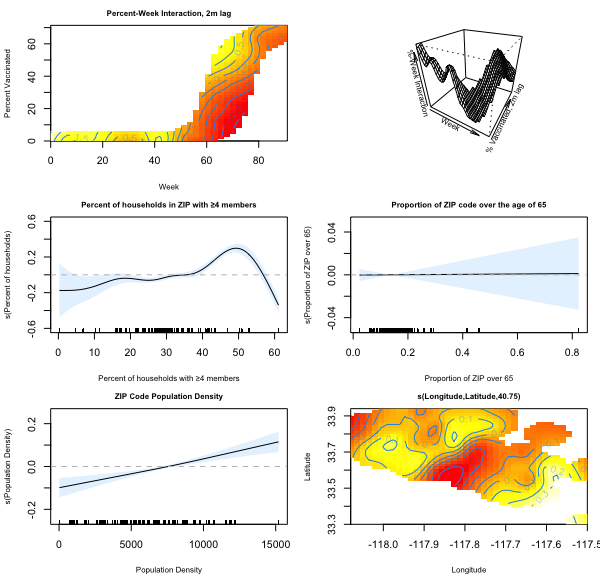

**Splines for Group 2: ages 50-64**  

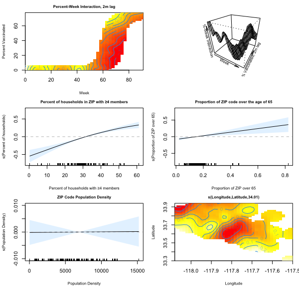

**Splines for Group 3: ages 65+**  

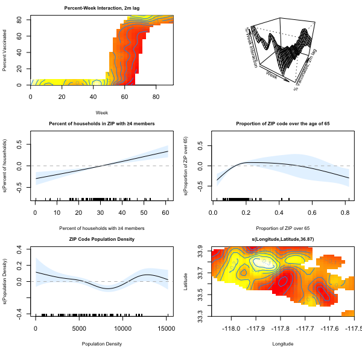  


---


